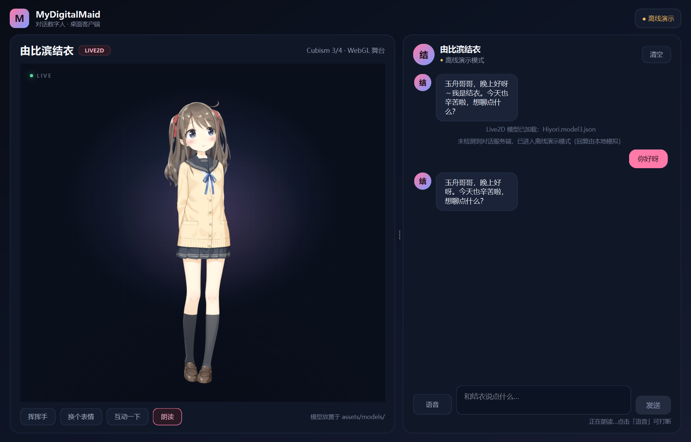

# MyDigitalMaid · 对话数字人桌面客户端

左侧 Live2D 舞台、右侧对话面板的桌面客户端。对话链路沿用原来的 `client.py` 协议，
服务端不在线时会自动进入本地演示模式；语音输入、语音播报和口型同步已经接通。



## 当前进度

- 左右分栏主窗口，深色主题、圆角卡片、自适应消息气泡；
- 左侧 QtWebEngine 承载 Live2D 舞台，支持 Cubism 3/4 模型、随机动作/表情、点击互动；
- 暂未找到模型时显示全息占位动画，不会白屏；
- 右侧聊天面板：Enter 发送、Shift+Enter 换行、正在输入动画、系统消息、清空会话；
- 已接入原有 socket 协议（默认 `127.0.0.1:8888`），控制码会驱动 `actions.py`
  里的开灯、空调、泡茶、做饭、打扫，并在界面上回显动作；
- **语音输入**：点击「语音」开始录音，自动检测说完后结束；识别结果走正常对话流程；
- **语音回复**：收到回复后自动调用 GPT-SoVITS（`127.0.0.1:9880`）逐段合成并连续播放，
  播放音量实时驱动 Live2D 嘴型；
- **朗读开关**：舞台下方「朗读」按钮可随时开关；TTS 服务不可用时会提示并自动关闭；
- 朗读过程中点击「语音」会先停止朗读，再开始录音（可打断）。

## 运行

项目使用 `MydigitalMaid_client` 这个 conda 环境（Python 3.12）：

```powershell
conda activate MydigitalMaid_client
pip install -r requirements-gui.txt
python app.py
```

可选参数：

```powershell
python app.py --host 127.0.0.1 --port 8888
# 启动时关闭自动朗读
python app.py --no-speak
# 调试用：自动发一条消息并截图
python app.py --demo-chat "帮我把灯打开" --screenshot artifacts/ui.png
```

### 语音链路

```
麦克风 → recorder（VAD 自动断句）→ Qwen3-ASR → socket 服务端
                                              ↓
扬声器 ← TTSPlayer（GPT-SoVITS 逐段合成）← 回复文本
                    ↓ 播放音量
             Live2D 口型（ParamMouthOpenY）
```

- ASR 模型（`voice2text/Qwen3-ASR-1___7B`）在第一次点击「语音」时才加载，
  首次大约 15 秒，之后常驻显存复用；
- 录音在后台线程完成，不会阻塞界面；自动等待说话最多 8 秒，检测到人声后
  静音约 1.3 秒自动结束；
- TTS 服务地址和参考音频在 `TTS.py` 顶部配置，默认是 GPT-SoVITS 的 `/tts` 接口；
- 没有启动 GPT-SoVITS 时可以先用假服务联调：

```powershell
python tools/fake_tts_server.py --port 9880
```

### 首次准备 Live2D 资源

```powershell
python tools/fetch_assets.py
```

脚本会下载 pixi.js、Cubism Core、pixi-live2d-display、qwebchannel.js 到
`web/vendor/`，并把 Live2D 官方示例模型 Hiyori 下载到 `assets/models/hiyori/`。
如果只想用自己的模型，可以跳过模型下载：

```powershell
python tools/fetch_assets.py --no-model
```

然后把模型按原目录结构放进 `assets/models/` 的任意子目录，客户端会自动加载第一个
`*.model3.json`；也可以用环境变量指定：

```powershell
$env:MYDIGITALMAID_MODEL = "assets/models/你的模型/model3.json"
python app.py
```

## 目录结构

```
app.py                      入口：命令行参数、主题、主窗口
ui/
  main_window.py            左右分栏、语音/朗读状态机、动作分发
  chat_panel.py             消息列表、气泡、输入框、连接与语音状态
  live2d_view.py            QWebEngineView + QWebChannel 桥接
  theme.py                  全局深色 QSS 与调色板
backend/
  chat_worker.py            socket 协议线程 + 离线演示回复
  asset_server.py           127.0.0.1 临时静态资源服务（供 WebEngine 加载模型）
  asr_engine.py             Qwen3-ASR 懒加载与识别
  recorder.py               麦克风录音 + 简单 VAD
  voice_service.py          「加载 → 录音 → 识别」后台服务
  tts_player.py             GPT-SoVITS 分段合成、连续播放、音量回报
web/
  live2d.html / stage.css / stage.js   Live2D 舞台页面（含口型钩子）
  vendor/                   前端运行时（由脚本下载）
assets/models/              Live2D 模型
tools/
  fetch_assets.py           下载运行时与示例模型
  fake_tts_server.py        本地假 TTS，方便没有 GPT-SoVITS 时联调
  smoke_*.py                无界面冒烟测试
  check_lipsync.py          单独截图验证口型
```

## 对话协议

与 `client.py` 保持一致，消息以 `$` 结尾：

1. 客户端发送 `文本 + "$"`；
2. 客户端发送 `家庭状态.to_prompt() + "$"`；
3. 服务端返回 `回复 + "$"`；
4. 服务端返回 `控制码字符串 + "$"`（如 `"13"` 表示依次执行开灯、开空调）。

控制码到动作的映射在 `actions.py`，界面只负责展示结果。

## 常见问题

- **第一次点「语音」很久没反应**：正在加载 1.7B 的 ASR 模型（约 15 秒，需约 4GB 显存），
  输入区会显示「首次加载语音模型」；
- **提示语音合成服务未启动**：先启动 GPT-SoVITS 到 `127.0.0.1:9880`，再点一下舞台下方的
  「朗读」重新开启；
- **麦克风没反应**：确认系统默认输入设备可用，且没有被其他程序独占；
- **模型嘴型不动**：只有包含 `ParamMouthOpenY` 参数的 Cubism 3/4 模型支持口型。

## 下一步

- 流式 ASR / 边录边识别，进一步降低语音输入的等待感；
- TTS 音色、语速和情绪参数化（目前固定使用 `TTS.py` 里的参考音频）；
- 把动作、表情和回复语义绑定，做成更完整的角色表现层；
- 打包成独立桌面程序（PyInstaller / Nuitka）。
